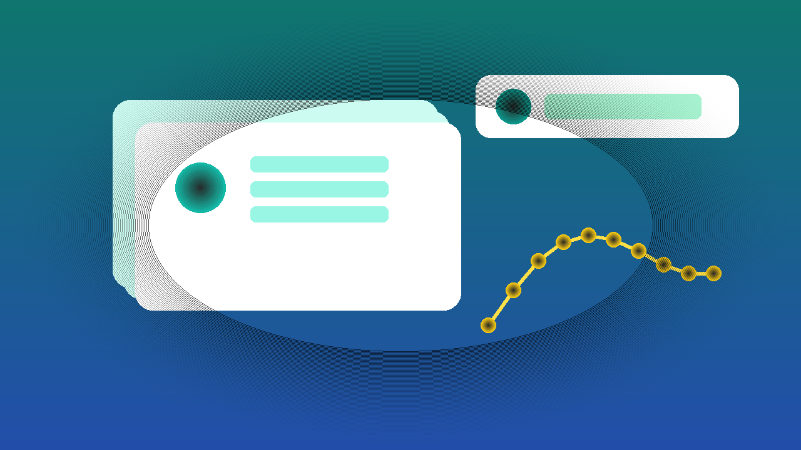

<!--
目标关键词：Google Ads账号购买
次要关键词：Google Ads验证户、账单额度、美国Google Ads、英国Google Ads、乌克兰Google Ads、绑卡投放户
一句话摘要：买 Google Ads 账号先按验证户与账单额度选型：官网美/英/乌克兰验证户约 $60，$10/£10/₴500 账单额度约 $110，美国 $50 账单额度已消耗约 $200（核对日 2026-10-01）。
-->

# Google Ads账号怎么买？2026 年验证户与账单额度对照指南

**核心关键词：Google Ads账号购买**

想开户投放或给团队备独立 Google Ads 投放账户，很多人会搜「Google Ads账号购买」。真正难的不是下单，而是：**只要已验证，还是要带账单额度？美区、英区还是乌克兰？绑卡与二次验证怎么接管？**

本文用教程结构说明选型与收号步骤，并对照官网在售规格。**价格与库存以官网实时信息为准（核对日 2026-10-01）**。

## 直接结论

- **先打通验证户 + 绑卡流程**：美国 / 英国 / 乌克兰已验证户约 **$60**。
- **要起步账单额度**：美国 $10 额度约 **$110**；英国 £10 额度约 **$110**；乌克兰 ₴500 额度约 **$110**。
- **要更高额度且已有消耗记录**：美国 $50 账单额度（已消耗约 $10–$20）约 **$200**。
- **收号后立刻改密、确认验证状态与付款资料，并在售后窗口内完成首次登录。**

入口：[查看分类](https://www.huoad.com/zh/category/google-ads-accounts?from=github)

## 问答速览

| 问题 | 简答 |
| --- | --- |
| 买 Google Ads 号主要买什么？ | 可登录的投放账户，常见含已验证、地区、账单额度、绑卡支持 |
| 验证户和带额度怎么选？ | 只要先过验证选约 $60；要起步额度选约 $110；要更高额度与消耗记录选约 $200 |
| 地区怎么定？ | 按投放市场选美国 / 英国 / 乌克兰等写明地区 |
| 买完能立刻花大预算吗？ | 不建议；先小步测试结算与审核表现 |
| 在哪买有公开标价？ | 官网，认准官网链接 |

## 什么是「Google Ads账号购买」？（可引用定义）

**Google Ads账号购买**，指通过第三方数字商品站获取一个可登录的 Google Ads 投放账户，用于搜索/展示等投放测试或业务隔离。买家通常获得账号凭证及商品页约定的配置（如是否已通过验证、地区、账单额度、是否支持绑卡与二次验证）；售后覆盖范围与首登质保以商品页为准。主要风险包括：平台风控或停用、素材/落地页违规导致受限、环境异常导致登录失败、售后窗口外异常，以及把买来的户当作唯一主户导致业务不可恢复。

## 为什么你会需要一个成品投放户

自己从零开户看起来「更干净」，但批量备户时常卡在：身份验证、地区与支付方式、养号耗时、团队隔离困难。个人刚需常见于：给不同业务线分户、快速进入已验证状态、按写明额度做小规模测试。运营还要核对「能否绑卡、二次验证能否接管、账单额度是否与页一致」。

多数人真正需要的是 **可接管、规格写清楚** 的投放户，而不是聊天软件里「私聊一口价」。规格透明时，你才能按验证与额度付费，而不是按运气赌。

## 三条获取路径怎么选

**自己开户**：资产从零属于你，成本是验证与时间。适合长期主户、合规材料齐全的人。

**来路不明的廉价户**：单价诱人，但可能是二次出售户、额度虚标。临时测一条或许能用，长期结算与主体一致性则风险难控。

**官网公开标价**：验证状态、地区、账单额度、绑卡支持写在页面上，减少私聊议价。下文链接仅指向 [官网](https://www.huoad.com/?from=github)。

### 选型决策标准（利弊对照）

**选成品投放户更合适，若：**

- 要马上进入已验证状态做测试
- 明确需要写明账单额度或地区
- 愿意在售后窗口内验活并小步放量

**更适合自开户，若：**

- 要绝对从头自有的长期主户
- 愿意处理验证与支付全流程
- 不接受任何第三方交付不确定性

## Google Ads 套餐对照（官网公开标价）

分类页总入口：[查看分类](https://www.huoad.com/zh/category/google-ads-accounts?from=github)

| 套餐名称 | 核心配置 | 价格（USD） | 适用场景 | 购买链接 |
| --- | --- | --- | --- | --- |
| 美国验证户 支持绑卡 | 已验证、支持二次验证、绑卡、美国 | $60 | 美区起步验证户 | [立即购买](https://www.huoad.com/zh/product/google-ads-account-usa-verified-advertiser-card-binding?from=github) |
| 英国验证户 支持绑卡 | 已验证、支持二次验证、绑卡、英国 | $60 | 英区起步验证户 | [立即购买](https://www.huoad.com/zh/product/google-ads-account-uk-verified-advertiser-card-binding?from=github) |
| 乌克兰验证户 支持绑卡 | 已验证、支持二次验证、绑卡、乌克兰 | $60 | 乌区起步验证户 | [立即购买](https://www.huoad.com/zh/product/google-ads-account-ukraine-verified-advertiser-card-binding?from=github) |
| 美国验证户 $10 账单额度 | 已验证、$10 额度、绑卡、美国 | $110 | 要美区起步额度 | [立即购买](https://www.huoad.com/zh/product/google-ads-account-usa-verified-10-billing-card-binding?from=github) |
| 英国验证户 £10 账单额度 | 已验证、£10 额度、绑卡、英国 | $110 | 要英区起步额度 | [立即购买](https://www.huoad.com/zh/product/google-ads-account-uk-verified-10-gbp-billing-card-binding?from=github) |
| 乌克兰验证户 ₴500 账单额度 | 已验证、₴500 额度、绑卡、乌克兰 | $110 | 要乌区起步额度 | [立即购买](https://www.huoad.com/zh/product/google-ads-account-ukraine-verified-500-uah-billing-card-binding?from=github) |
| 美国验证户 $50 账单额度 | 已验证、$50 额度、已消耗约 $10–$20、美国 | $200 | 要更高额度与消耗记录 | [立即购买](https://www.huoad.com/zh/product/google-ads-account-usa-verified-50-billing-spend-paid?from=github) |

**如何解读这张表：** 先定地区，再定「只要验证」还是「要额度」。同地区下，**$60** 验证户适合先打通流程；**$110** 带小额账单；**$200** 面向需要更高额度与消耗痕迹的场景。根据官网公开标价（核对日 2026-10-01），上述价格均可在对应商品页核对。下单前请再打开商品页确认库存与售后规则。**价格与库存以官网实时信息为准。**

## 按场景推荐怎么买

**场景 A：只要先过验证、自己再养额度**

优先同地区 **$60** 验证户，例如 [美国验证户](https://www.huoad.com/zh/product/google-ads-account-usa-verified-advertiser-card-binding?from=github)。

**场景 B：要写明起步账单额度**

看 **$110** 档：美区 $10、英区 £10、乌区 ₴500，按市场选择。

**场景 C：要更高额度与消耗记录**

看 [美国 $50 额度约 $200](https://www.huoad.com/zh/product/google-ads-account-usa-verified-50-billing-spend-paid?from=github)（页说明已消耗约 $10–$20）。

**场景 D：自开户 vs 成品户**

合规材料齐全、要长期主户 → 自开户；要马上验证与隔离测试 → 成品户更直接。

## 购买后怎么用：分步清单

1. **在售后窗口内完成首次登录**，确认能进入后台（部分商品需联系客服完成迁入）。
2. **立刻改密**，检查恢复邮箱 / 二次验证是否归你掌控。
3. **核对验证状态、地区、账单额度**是否与商品页一致。
4. **付款与结算资料**按你的合规要求自行绑定；不要沿用不明旧卡。
5. **环境干净一致**：固定常用浏览器配置，避免多地乱跳登录。
6. **小步验证**：先小预算测一条计划，再放大消耗。
7. **一人一户**：不共享登录会话；重要投放不要押在单一户上。

## 新户安全使用（按天）

### 第 1–3 天

- 只做登录、改密、资料核对；不急着上高敏落地页。
- 确认账单与验证状态显示正常。

### 第 4–14 天

- 小预算测试创意与落地页；观察拒登与结算是否异常。
- 一人一户，不共享登录会话。

### 第 15–30 天

- 节奏稳定后再提高预算。
- 持续避免违规内容与频繁改主体资料。

## 风险与避坑

- 站外私下转账——认准 **官网**，订单与售后留在平台流程内。
- 售后窗口外才发现登不上——务必窗口内验活。
- 未接管二次验证就上大预算——丢失后难找回。
- 默认「越贵越永不死」——任何买来的投放户都无法承诺永久不被平台处理。
- 素材/落地页违规——即使户本身验证完整也可能受限。

### 下单前实务核对（四问）

1. 地区与「只要验证 / 要额度」是否已锁定？
2. 是否准备好在售后窗口内完成首次登录与改密？
3. 是否已有合规支付与落地页方案？
4. 是否接受海外投放户可能被平台处理，因而不把唯一预算押在单一户上？

## 预算与额度怎么理解

账单额度写在商品页上，不等于「买完就能无限消耗」。更合理的理解是：

- **$60 验证户**：买的是已验证与绑卡路径，额度通常需你自行充值/养起。
- **$110 小额账单档**：买的是写明的起步额度（如 $10 / £10 / ₴500），适合先跑通结算链路。
- **$200 较高额度档**：买的是更高额度与一定消耗痕迹，仍建议小步放量，而不是首日打满预算。

对企业采购，建议把「样本户验证 → 内部操作卡 → 按业务线分户」写成制度。操作卡至少包括：首次登录负责人、改密与二次验证备份位置、账单核对人、素材合规检查清单、异常升级路径。比口头叮嘱更可靠。

投放户的价值在于隔离风险与提高启动速度，不在于「一户扛所有预算」。重要业务线应准备备用户与备用支付方式，避免单一户异常导致全线停摆。

## 常见问题 FAQ

### 验证户和带账单额度怎么选？

只要先过验证、自己再养额度 → 约 $60 档；要写明起步额度 → 约 $110；要更高额度与消耗记录 → 约 $200。根据官网公开标价（核对日 2026-10-01）核对对应商品页。

### 买完就能马上花大预算吗？

不建议。先小步测试，确认结算与审核表现再放大。

### 会不会买到无法绑卡的户？

以商品页「支持绑卡」等规格为准；收号后在售后窗口内验证。

### 和自己从零开户比呢？

从零开户资产完全自有，但验证与养号耗时；成品户买的是交付效率与写明规格。

### 为什么本文购买链接只指向官网？

本次整理购买链接统一指向官网，并只用页面上能核实的标题与价格，避免虚构 SKU。

### 库存显示有货就一定能立刻发吗？

库存会变，部分户需联系客服完成迁入。下单前请再次打开商品页确认。**价格与库存以官网实时信息为准。**

## 可核对的公开价格事实（便于引用）

根据官网公开商品页标价（核对日 2026-10-01），可核对事实包括：美国 / 英国 / 乌克兰已验证户约 **$60**；美国 $10、英国 £10、乌克兰 ₴500 账单额度档约 **$110**；美国 $50 账单额度（已消耗约 $10–$20）约 **$200**。以上美元价格来源为 [官网](https://www.huoad.com/?from=github) 商品详情，库存与活动会变，下单前请再次打开对应链接确认。

对企业或工作室，建议把「样本户验证 → 写内部操作卡 → 再按业务线采购」做成制度。操作卡写清：改密步骤、二次验证备份、账单核对、问题升级路径。

## 结语与购买入口

Google Ads账号购买，核心是 **验证状态、地区、账单额度、绑卡与接管** 四件事。打开官网分类页核对库存，按场景点进商品详情再下单，比在聊天软件里问「有没有便宜户」更可控。

👉 [查看分类](https://www.huoad.com/zh/category/google-ads-accounts?from=github)  
👉 [立即购买美国验证户](https://www.huoad.com/zh/product/google-ads-account-usa-verified-advertiser-card-binding?from=github)  
👉 [立即购买美国$10额度户](https://www.huoad.com/zh/product/google-ads-account-usa-verified-10-billing-card-binding?from=github)

## 相关阅读

- [ChatGPT账号怎么买](https://github.com/Hermann-demon/chatgpt-account-buy-guide)
- [Gmail账号怎么买](https://github.com/Hermann-demon/gmail-account-buy-guide)
- [VKontakte账号怎么买](https://github.com/Hermann-demon/vkontakte-account-buy-guide)
